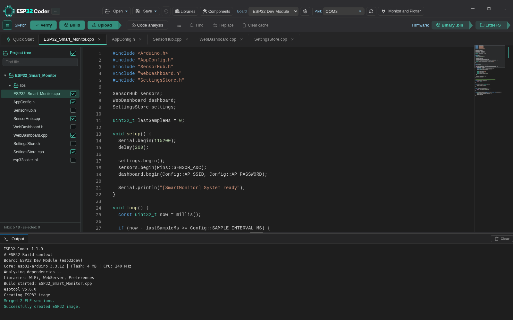
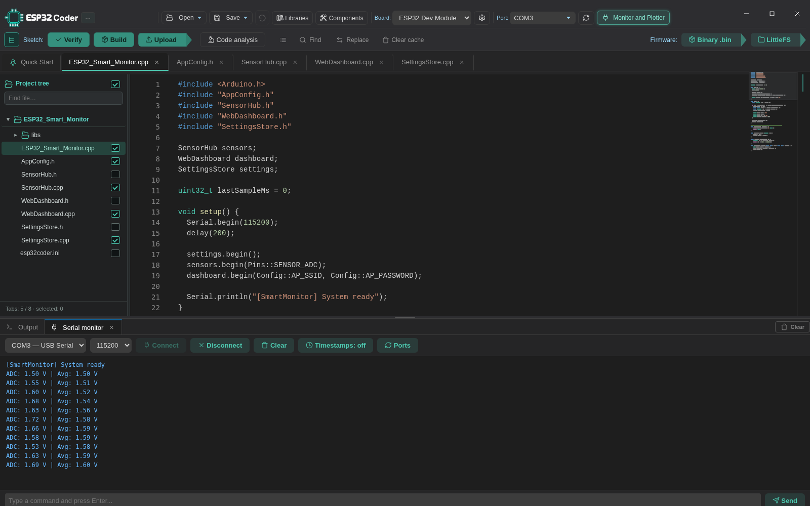
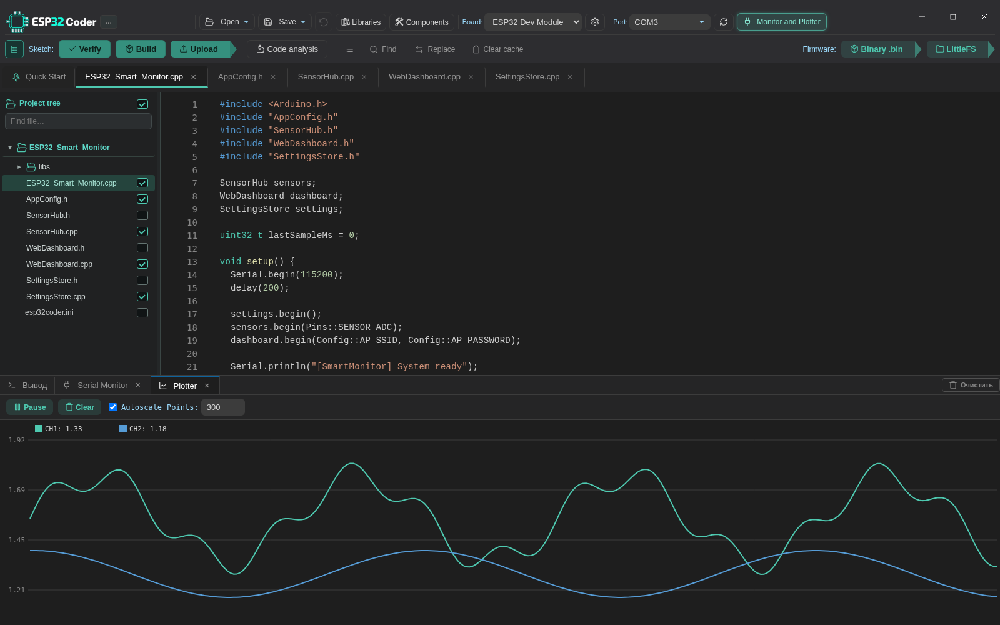

### Free portable offline IDE for ESP32 on Windows

The simplicity of Arduino sketches + the power of PlatformIO projects — in one standalone app. 
No VS Code, no plugins, no VPN.

**[⬇️ Download for Windows](https://github.com/RAAMVZ/ESP32-Coder/releases/latest)** ·
**[🌐 Website](https://raamvz.github.io/ESP32-Coder/en.html)** ·
**[📖 Docs](https://raamvz.github.io/ESP32-Coder/docs-en.html)** ·
**[🇷🇺 Русская версия](https://raamvz.github.io/ESP32-Coder/)**

 

---

## ✨ Why ESP32 Coder

| | |
|---|---|
| ◎ **Works offline** | No VPN needed. Fully offline once components are installed. |
| ▣ **All in one app** | Editor, compiler, flasher, Serial Monitor and Plotter. |
| ϟ **Turbo builds** | Multicore parallel compilation, persistent object cache, ccache. |
| ◇ **Smart dependency scan** | Finds required libraries via `#include` and skips unused sources. |
| ⬡ **Whole ESP32 family** | ESP32, S2, S3, C3, C6 and H2 boards and modules. |
| ⇣ **Easy import** | Open Arduino IDE and PlatformIO projects together with their libraries. |
| ◌ **No forced updates** | No forced component updates, plus quick rollback to earlier core and library versions. |

## 🚀 Quick start

1. Download the **ZIP archive** from the [latest release](https://github.com/RAAMVZ/ESP32-Coder/releases/latest)
   *(the separate `.exe` asset is used by the built-in updater)*.
2. Unpack it anywhere — no installation required — and run **ESP32 Coder**.
3. Open **Components** and install the Arduino ESP32 Core and toolchain for your chip.
4. Create a project or import an existing one, pick your board and port, then press **Upload**.

Want to try it right away? Grab a sample project:
[ESP32 Smart Monitor](docs/assets/ESP32_Smart_Monitor_Coder.zip) ·
[Arduino import example](docs/assets/Arduino_Import_Example.zip) ·
[PlatformIO import example](docs/assets/PlatformIO_Import_Example.zip)

## 📸 Screenshots

<table>
  <tr>
    <td align="center"> <b>Serial Monitor</b></td>
    <td align="center"> <b>Real-time Plotter</b></td>
  </tr>
</table>

## 🧰 Features

<b>Projects</b>

- Create and open projects, browse recent projects, restore deleted items
- Import Arduino IDE and PlatformIO projects; work with multiple files
- A dedicated `libs/` folder for each project's libraries

<b>Code editor</b>

- Syntax highlighting for C/C++, HTML, CSS and JavaScript; autocomplete, folding, file tabs
- Matching brackets and HTML tags, nesting guides
- Regex search & replace; jump to files, symbols and definitions (`Ctrl+P`, `F12`)
- Line operations: comment, duplicate, move

<b>Build & cache</b>

- Verify and build ESP32 firmware with multicore parallel compilation
- Object cache reused across builds and restarts; ccache support
- Build progress, cache statistics, ⚡ / ♻️ markers, cancel at any time
- Static analysis with cppcheck; copy errors for AI analysis in one click

<b>Libraries & components</b>

- Library Manager: install, update, pin versions, import from a folder
- Search libraries on GitHub; detect dependencies from `#include`
- Components Manager: Arduino ESP32 Core, SDK and toolchain for the selected chip
- Version check for core, SDK, tools and libraries

<b>Flashing & tools</b>

- Upload compiled firmware or flash a ready-made `.bin` via esptool
- Build and flash LittleFS filesystem images separately
- Serial Monitor and graphical Plotter

## 🔒 Security & trust

Every release is checked and signed, and the reports are public:

- **[VirusTotal scan results](https://raamvz.github.io/ESP32-Coder/security-en.html)**
- **[Sigstore build attestation](https://raamvz.github.io/ESP32-Coder/sigstore-en.html)** — proves the binary was built by GitHub Actions from this repository
- **[Code security audit](https://raamvz.github.io/ESP32-Coder/audit-en.html)**

## ❓ FAQ

<b>Do I need Arduino IDE or VS Code?</b>

No. ESP32 Coder is a standalone Windows app. Required SDKs and toolchains are installed from its interface.

<b>Can I flash a .bin without the source code?</b>

Yes, if the BIN matches the target board and its flash layout.

<b>Can LittleFS be flashed independently?</b>

Yes. A separate mode writes a prepared LittleFS image — use the correct partition address and layout.

<b>How do I get updates?</b>

Download the latest GitHub Release or use the app's built-in signed-update check.

## 💬 Feedback

Found a bug or have an idea? [Open an issue](https://github.com/RAAMVZ/ESP32-Coder/issues) — and if ESP32 Coder saves you time, a ⭐ helps other makers find it.
